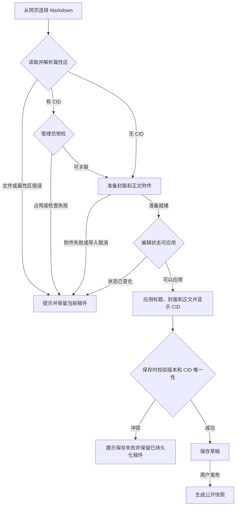

# 文章导入的技术设计

> 功能依据：[文章 Spec](spec.md) · 2026-11-28 用户确认
> 设计状态：已写完
> 本轮范围：feat01–feat04、C1–C3，本轮基线 `1dcae7e`

## 范围与模块边界

| 入口 | 职责 |
| --- | --- |
| [`markdown-import`](../../../src/modules/markdown-import/README.md) | 解析网页导入的属性区和开头标题，先检查 CID，复用现有附件计划读取和上传封面 |
| [文章编辑页](../../../src/components/editor/Editor.tsx) | 在同一次确认中应用标题、正文、封面和 CID。在现有文章信息行展示 CID |
| [文章服务](../../../src/server/content/service.ts) | 检查文章身份和 CID 占用，执行版本校验和保存，生成公开快照 |
| [文章 API](../../../src/server/api.ts) | 管理员预检和文章操作，公开响应使用公开数据 |

## 必须遵守的技术约束

| 规则 | 回指 | 判据 |
| --- | --- | --- |
| D01 属性先于附件 | feat02 场景1、feat03 场景1、C3 | 仓库和手动入口共用属性解析和管理员 CID 预检。仓库读取 Markdown 后先验证 CID，再扫描、枚举或读取引用附件。CID 失败沿用当前编辑内容 |
| D02 封面复用 | feat01 场景1–3 | 封面和正文图片共用现有路径、类型、授权、缓存及上传机制。身份按实际解析出的文件比对，仅移除重复的正文首图。仅在准备成功且编辑状态仍可应用时一起更新封面、正文、标题和 CID |
| D03 CID 的所有权 | feat03 场景1–2、C3 | CID 随已持久化草稿的文章身份保存。预检按当前文章身份排除自身，查到其他文章或试图更换已关联 CID 时返回明确错误。保存阶段由数据库唯一约束防并发冲突，错误可回到导入提示，版本更新继续使用现有机制 |
| D04 管理员与公开数据 | feat02 场景1–2、C1–C2 | 当前管理员的编辑详情可读 CID，现有文章信息行直接展示。发布快照、公开列表与详情、RSS 和集成令牌响应排除内部 CID。插件和 CLI 沿用现有 Markdown 契约 |
| D05 标题与正文 | feat04 场景1–2 | 两种网页入口共享标题提取。文件头 `title` 优先，否则取可直接提取文字的首块 H1。按 Markdown 解析后的显示文本比较，只移除与采用标题一致的首块 H1。导入成功后站内标题和正文一起更新 |

## 验收矩阵

| 用例 | 操作 | 通过条件 |
| --- | --- | --- |
| T1 **Smoke** · feat01、feat02 | 从真实网页导入带 CID、封面路径和重复首图的合成 Markdown，保存、刷新、发布，再访问公开页和接口 | 上传一次，封面一次，正文没有重复图。管理员在现有信息行看到 CID，公开响应只含公开字段 |
| T2 **Smoke** · feat03、C3 | 在数据库已有相同 CID 的情况下选择 Markdown，分别从仓库和手动入口进入 | 在附件读取和上传前停止，见到清晰冲突提示，原编辑状态保持 |
| T3 · feat01 场景1、3 | 导入正文未引用的封面，再分别模拟缺图及上传失败 | 封面专用图片可用。失败时封面、正文和内部信息无变更 |
| T4 · feat03 场景1、2 | 以相同、缺省、不同 CID 重导当前文章，再并发保存两个相同 CID 的新稿件 | 相同或缺省 CID 可重导，换号停止，并发只能成功保存一篇 |
| T5 · feat02 场景2 | 依次读取管理员编辑详情、公开列表、公开详情、RSS、集成令牌响应 | CID 只在管理员编辑读路径返回 |
| T6 **Smoke** · feat04 | 手动导入带 YAML 标题及同名 H1 的稿件，再从仓库重导已存在的稿件 | 标题栏得到 Markdown 标题，保存请求和公开页只有一份文章标题，章节标题、封面及正文照常显示 |

## 本地验收结果

- Node 24 类型检查为 0 错误，Worker 构建成功，Vitest 1108 项全部通过，集成回归 23 项全部通过。
- Chrome 通过 15 个导入相关场景。仓库场景使用浏览器原生 OPFS 句柄和受控选择器，确认冲突时只读 Markdown，附件读取和上传数均为零。当前文章使用相同 CID 重导后，封面完成自动设置。
- Chrome 用例验证 YAML 标题和同名 H1 从正文分离，草稿保存后的标题来自 Markdown，公开页只有一个一级标题。仓库重导同样提取标题，原有封面和 CID 流程通过。
- 本地 Worker 的公开页面、列表、详情和 RSS 验证通过。集成令牌的字段隔离与写入权限由 API 测试覆盖。
- 本地 D1 已应用 [CID 唯一索引迁移](../../../drizzle/0006_posts_cid.sql)。上线需按仓库发布规则先将该迁移应用到生产 D1。
