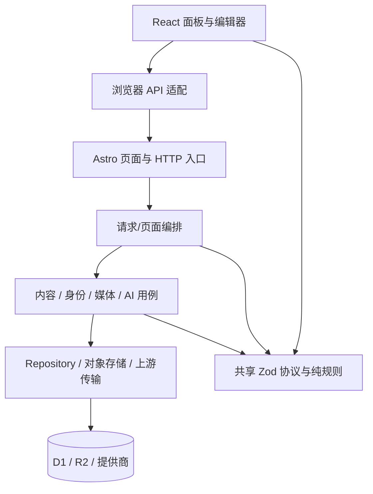

# MadeMe Studio 架构审查 — 20261031-004542

> 公开版说明：本报告分析该公开仓库的版本化源码。验证记录以汇总形式交付；本机路径、逐文件指纹、原始内部日志与完整机器依赖图保留在本地证据目录。

> 发布基线说明：本报告与反例绑定本地 `67f02f06ac7ebc4400e47a54b315018120ac3588` 快照。归档 PR 基于远端 `09dbd849aad58fc34b93126baeb2832ead4f171a`，两者之间有 6 个后续提交；各问题在最新 main 中的状态由下一轮巡检重新验证。

**结论：总体模块化单体架构合理，核心内容与存储分工清晰；认证依赖、跨入口规则与交付链已经出现局部腐化和漂移。建议保留现有架构，优先修复已复现的问题，再收敛依赖方向。**

**Review 日期：** 2026-10-31（Asia/Shanghai）  
**Completed by model:** GPT-6  
**审查项目：** `MadeMe-studio 工作区`（package name: `mademe-studio`）  
**基线：** `67f02f06ac7ebc4400e47a54b315018120ac3588`，纳入当前工作区已有 Docker/部署改动。应用源码保持原样；本次新增报告与复现证据。

## 直接回答五个架构问题

| 问题 | 判断 | 证据与含义 |
|---|---|---|
| 总体设计是否正确 | 适合当前个人创作工作台 | Astro SSR + React 交互、D1 结构化状态 + R2 媒体、模块化单体，部署和状态一致性成本可控。 |
| 模块边界是否清晰 | 内容服务/存储/媒体权限边界较清晰，认证与共享 UI 边界需要收敛 | PostService 与 repository 职责明确；identity/password 的编排回流、settings/AI 双向领域依赖见 A1/A3。 |
| 职责是否单一 | 核心后端领域职责集中；认证、shared/ui、Editor 同时承担多个变化方向 | 具体混合职责、共享状态及切分边见 A1/A5/A6。 |
| 是否违反既有约定 | 已复现配置统一、链接语义和失败日志的实现偏移 | B3/B4/B5 分别对应 SSR 配置、mailto 渲染和资源失败记录。B1/B2 为迁移/打包依赖闭包漂移。 |
| import 是否形成循环 | 存在 1 个运行时强连通组 | auth 的 identity/google/password；包含类型边时还有 config/embed 的声明依赖环。 |

## 已复现的问题及优先级

以下行为问题由 [x-cr 报告](../cr/cr-report-20261031-004542.md) 提供稳定 Bn 编号、最小反例及修复验收。架构问题使用 A1–A6 编号；两组计数按各自量尺统计，部分条目关联同一根因。

| ID | 正确性等级 | 已验证结果 | 优先处理方向 |
|---|---|---|---|
| B1 | P1 | db:generate 重复生成 ADD display_name；已有迁移执行后再应用报 duplicate column name | 同步 migration、snapshot、journal 与 schema，补迁移生成后可继续应用的检查。 |
| B2 | P1 | 按 package 脚本清单生成的暂存源码缺 config/limits.ts，集成测试加载失败 | 打包共享协议的完整依赖闭包，或建立可独立构建的协议包。 |
| B3 | P1 | 配置 20 条、库内 25 条：Studio SSR=25、Media SSR=25、HTTP=20 | SSR 与 API 共用同一媒体用例和请求配置。 |
| B4 | P1 | mailto 链接保存/发布成功，阅读 HTML 只输出普通文字 | 统一 href 规则，媒体/下载场景保留各自具名策略。 |
| B5 | P2 | SSR 媒体查询失败展示错误文案，结构化异常记录次数为 0 | allSettled 每个 rejected 分支保留脱敏错误与请求上下文。 |

**正确性计数：P0=0，P1=4，P2=1。架构计数：P1=1，P2=5，P3=0。** 当前证据证明上述边界结果；线上身份网关、真实 OAuth/模型账户、浏览器原生目录授权和全站交互验收各有独立范围。

## 当前架构与建议保持的依赖方向

同一单体内允许用例之间有显式依赖，例如 AI 图像生成调用媒体存储、媒体授权读取已发布文章引用。平台能力由入口注入，纯规则和跨端协议应保持独立的依赖闭包。

## 声明约定与实际结构

| 边界 | 声明约定与证据 | 实际结构与判断 |
|---|---|---|
| 平台入口 → 应用 | `src/middleware.ts:11-14` 注入运行时；`src/server/runtime.ts:35-70` 定义最小能力 | Workers 专用模块停留在 middleware；业务通过 RuntimeEnv 消费 D1/R2。方向合理。 |
| HTTP → 内容服务 → repository | `src/server/README.md:7-14`；`src/server/content/service.ts:13-14` | `api.ts` 编排身份、校验与服务调用；PostService 拥有版本与发布状态机；repository 承担参数化 SQL、CAS 与 batch。分工合理。 |
| 草稿与发布读取 | `docs/SECURITY.md` 内容边界；`src/server/content/service.ts:101-112` | 发布建立快照；`page-data.ts:107-134` 按读取身份选择数据；媒体访问重新检查已发布引用与阅读权限。核心归属清晰。 |
| AI 出站与存储 | `src/server/ai/README.md` 文件分工 | text/images/models/protocols/transport 分工明确；images 调用 media 存储属于显式用例依赖。settings 与 AI 的依赖仍需收敛，见 A3。 |
| 工作台外壳 → 业务面板 | `src/components/studio/README.md`；`src/modules/studio-navigation/README.md` | Shell 协调导航、身份与设置离开保护；Dashboard/MediaLibrary/SettingsPanel/Integrations 自持业务状态。当前分工符合常驻面板设计。 |
| 共享规则 | `docs/DEVELOPMENT.md:5,12`；`src/shared/README.md` | Zod、上传检查、嵌入注册表已共用。URL 渲染规则和 SSR 配置入口出现行为漂移；共享契约的归属也有局部回流。 |
| 本地导出 → 浏览器目录适配器 | `src/modules/local-export/README.md`；`src/modules/obsidian-local/README.md` | prepareExport 为纯准备，Obsidian 模块负责目录能力与用户确认，UI 复用共享 Modal。feature 内共置 UI 与 core 与现有模块说明一致。 |

## 依赖图判读

本次 TypeScript AST 静态图覆盖 143 个生产/集成/脚本/根配置 TS、TSX、JS、MJS、Astro 文件，包含 425 条内部边，其中 runtime 368 条、type 57 条。运行时强连通分量集中在 `src/server/auth/{identity,google,password}.ts`。类型图还覆盖 config schema/defaults/meta 与 embed registry/X provider 的声明依赖环；其中 import type 边在编译后擦除，应保留其类型耦合含义。`StudioShell → server/page-data` 也是类型边；此边确认契约归属问题；运行时泄漏需以浏览器产物另行取证。

## 总览

| 严重度 | 数量 | 事项 |
|---|---:|---|
| P1 架构债 | 1 | A1 认证入口、适配器与共享策略形成运行时环 |
| P2 建议修 | 5 | A2 导航所有权；A3 settings/AI；A4 跨端契约；A5 shared/ui；A6 Editor 工作流热点 |
| P3 信息项 | 0 | — |

## A1 [P1·依赖健康] 认证编排器与认证适配器形成运行时循环

- 证据：`src/server/auth/identity.ts:2` 导入 Google 配置/会话，`:7` 导入 password 配置/会话；`google.ts:15` 反向导入 identity 的 `assertSameOrigin`；`password.ts:17` 反向导入 identity 的 `authenticate/assertSameOrigin`；`password.ts:2` 同时导入 Google 配置和退出处理。
- 完整路径：`identity.ts → google.ts → identity.ts`；`identity.ts → password.ts → identity.ts`；`password.ts → google.ts → identity.ts → password.ts`。
- 当前职责：identity 同时定义 Identity、做身份分发、权限判断及 HTTP 同源策略；password 同时实现密码凭据/会话与所有认证模式的 presentation/session/logout 分发。认证适配器和认证编排器拥有相互调用的职责。
- 腐化机制：新增认证模式会同时触达编排器和既有适配器；共享策略调整会加载整个认证闭包；模块初始化和独立测试更依赖导入顺序。此结论确认结构环，当前相关身份回归通过，运行时初始化失败的判断需要新增反例。
- 建议：把 `Identity` 放在纯契约文件，把 `assertSameOrigin` 放在独立请求策略文件；Google/password 只提供配置态、会话读取与本模式登录/退出；统一 authenticate/session/logout 编排位于上层 auth service/handler。
- 目标方向：`HTTP handler → auth orchestration → google/password adapters → crypto/store`；所有层共同依赖纯契约与请求策略。

## A2 [P2·模块归属与单一事实源] 工作台导航规则由性能采集模块持有，路由元信息另有多份

- 证据：`src/modules/navigation-performance/protocol.ts:2-8` 定义 Route/StudioRoute，`:51-53` 定义路径解析；`StudioShell.tsx:23-26,108,239` 使用它决定历史恢复及内部导航接管；`src/layouts/StudioWorkspace.astro:6-8` 用它决定首个面板。
- 同一导航集合的副本：`navigation-performance/protocol.ts:2-7`、`StudioShell.tsx:44-49` 的路径/名称/icon、`src/layouts/Studio.astro:33-48` 的路径/名称/icon；当前四个路径一致。
- 契约：`src/modules/navigation-performance/README.md:3` 将该模块定义为独立性能插桩；`studio-navigation/README.md` 定义实际导航生命周期。
- 腐化机制：新增后台页要同步协议白名单与两份导航；某处遗漏会使新路由进入不同的导航路径。性能协议的变更也会影响核心路由识别。
- 建议：由 studio-navigation 持有 route schema、解析和共享导航元数据。性能采集依赖这份路由契约。布局和 React 外壳消费同一元数据，视图各自负责 icon/render。

## A3 [P2·模块边界] 设置持久化与 AI 运行时视图双向耦合

- 证据：`src/server/settings.ts:15-16` 导入 `ai/capabilities` 并转导出 `providerKey`；`:17-35` 的 redactSettings 给 provider 附加部署能力；`ai/text.ts:11`、`ai/images.ts:7` 同时从 settings 导入 readSettings/providerKey，`ai/models.ts:4` 经 settings 获取 providerKey。
- 模块级路径：`settings → AI capabilities` 与 `AI text/images/models → settings`。静态文件图中这组路径为单向链，运行时循环由 A1 单独列明。
- 当前职责：settings 同时保存作者配置、进行访客裁剪、填充 AI 部署能力、作为 AI 凭据选择器的转导出入口。AI 执行又依赖这个混合模块读取配置。
- 腐化机制：设置读写受 AI 展示契约牵动，AI 凭据的归属也被 settings 的转导出隐藏。新增能力字段会继续扩大 settings 的领域依赖。
- 建议：settings-store 只负责配置读写/校验，settings-view 或 page/application composition 负责部署能力与脱敏；AI 凭据选择从 capabilities 或专用配置模块直接导入。依赖收敛为 `AI → settings-store`、`settings-view → settings-store + AI capabilities`。

## A4 [P2·契约清晰度] 跨端 DTO 与 API 输出类型仍由调用端手工持有

- 证据：`src/server/page-data.ts:205-216` 手工定义 StudioPageData；`src/components/studio/StudioShell.tsx:20` 从 server 文件 import type。`src/components/shared/ui.tsx:20-23,69` 对调用者自由指定的 T 返回 `parseApiResponse(...) as T`；`api-protocol.ts:25-64` 单独手写端点与响应 schema 映射；多个消费者再次手写响应泛型。
- 契约：`docs/DEVELOPMENT.md:5`、`src/shared/README.md` 要求 Zod 为业务协议唯一来源。现有 HTTP 响应确实经过 Zod；TypeScript 的 T 与选中的 schema 缺少绑定。
- 腐化机制：跨端 Studio 数据类型随服务端 loader 演进，浏览器组件需要引用 server 命名空间；新增字段和端点时由作者自行保证泛型声明、route 分支与 schema 相符，类型检查无法证明三者一致。
- 建议：将 StudioPageData 提升为共享 schema 并从 schema 推导类型；API client 通过 endpoint 定义或显式 response schema 推导输出。先覆盖常用业务端点，以当前规模做最小收敛。

## A5 [P2·职责与依赖方向] shared/ui 混合网络边界、URL 业务规则和 UI primitive

- 证据：`src/components/shared/ui.tsx:9-78` 定义 ApiError/fetch/API 解析与身份失效事件；`:89-94` 定义可见性标签；`:95-234` 提供 Notice、Modal、SearchBox；`:235-246` 做 DOM 文件下载；`:247-260` 定义安全 URL 策略。
- 反向依赖：纯错误描述器 `components/editor/errors.ts:1` 导入 ui 中 ApiError；阅读渲染器 `content/BlockReader.tsx:3` 导入 ui 中 safeUrl。纯判定/错误类型的最小依赖闭包因此携带 React、icon、modal 和网络模块。
- 已漂移事实：`modules/content-check/index.ts:67-72` 允许 href 使用 mailto；`BlockReader.tsx:71-79` 使用 ui.safeUrl；后者 `ui.tsx:252-253` 仅接受 HTTP(S)。保存/发布允许的邮件链接在阅读显示中退化为文本，此行为已由 x-cr B4 实跑确认。
- 建议：将 API client/ApiError 归到独立 browser client 边界；将 URL policy 移至纯共享规则并按 href/media/download 用途提供具名函数；UI primitive 保留在组件模块，DOM download helper 作为 browser adapter。保存与呈现都从同一 href 契约出发，再实施各自 sink 校验。

## A6 [P2·职责单一热点] Editor 的多条独立工作流依赖同一组件闭包

- 证据：`Editor.tsx:84-124` 定义 BlockNote schema/字典；`:157-247` 定义稿件、模式、发布、面板、AI、修订及离开状态；`:249-283` 实现上传适配；`:304-338` 安装窗口/导航/快捷键处理；`:353-390` 实现视频建议与块修正；`:414-591` 保存/发布/载入；`:593-661` Markdown 文件转换；`:662-729` AI 建议请求/应用；`:746-807` 修订加载/恢复；`:1006-1018` 准备本地导出快照。
- 关键共享闭包：`currentRef`、`EditClock`、`lock`、BlockNote editor、dirty/busy、各类 setState。保存、导入、AI 和恢复分别重复处理 lock/busy/fail，并依赖同一个编辑序号语义。现有 editor-state/ai-request-state/editor-replacement/editor-navigation 已经提取了部分规则，组件仍承担多个变化方向的用例编排。
- 腐化机制：改动 AI 请求或 Markdown 导入会触达与发布/恢复共用的锁和编辑时钟，测试通常需要挂载整个编辑器并替换 BlockNote 与网络。这里的判断基于共享状态闭包和变化轴。
- 建议：保留唯一的 document session（当前稿、CAS 版本、编辑时钟、事务锁）；以该 session 作为显式参数提供 persistence、AI、Markdown、媒体上传的用例/hook；弹窗仅消费状态与命令。优先提取 API/文件转换适配和面板，保持保存/发布/恢复的原子锁归同一 owner；每次只移动一条工作流，复用现有竞态回归。

## 循环依赖的精确结论

| 类型 | 完整路径 | 当前影响 |
|---|---|---|
| runtime | identity.ts:2 → google.ts:15 → identity.ts | 身份分发与共享 HTTP 策略相互依赖，见 A1。 |
| runtime | identity.ts:7 → password.ts:17 → identity.ts | 密码适配器又承担通用 session/logout 编排，见 A1。 |
| runtime | password.ts:2 → google.ts:15 → identity.ts:7 → password.ts | 同一认证强连通组中的较长闭环。 |
| 含 type 边 | config/schema.ts:10 → defaults.ts:7（import type）→ schema.ts；schema.ts:20 → meta.ts:5（import type）→ schema.ts | 类型所有权回流，可将基础类型下移到独立文件。 |
| 含 type 边 | config/schema.ts:9 → embed/registry.ts:2 → providers/x.ts:1 → config/defaults.ts:7（import type）→ schema.ts | 配置 schema 依赖提供商注册表，提供商又读取配置默认值；闭环中的类型边在编译后擦除。 |

扫描覆盖 src、integrations、scripts 与根配置 143 个代码文件，内部依赖 425 条（运行时 368，类型 57）。使用 AST 提取 import/export、字面量动态 import/require、import type 和 Astro frontmatter/script，再计算强连通分量。源码的动态 import 为字面量，已进入图；CSS 本地导入登记为静态资产。第三方包的内部依赖及构建器虚拟模块属于独立图边界。

`settings ↔ AI` 属于领域模块级双向耦合，文件级运行时图为单向链。`StudioShell → server/page-data` 属于 import type。Obsidian feature 中 UI 共置并复用共享 Modal 符合现有 README；`api.ts` 的当前入口编排和 PostService/repository 分工也符合文档约定。

## 验证汇总

| 检查 | 实际结果 | 证据 |
|---|---|---|
| 后端、unit 与阅读规则回归 | 40 文件、360 项通过 | [验证汇总](architecture-review-validation-20261031.md) |
| 常驻工作台 loader/身份/初始资源回归 | 5 文件、20 项通过 | [验证汇总](architecture-review-validation-20261031.md) |
| 三条新增不变量反例 | 3 项失败，分别确认 B3/B4/B5 | [验证汇总](architecture-review-validation-20261031.md) |
| 集成打包暂存阶段 | 1 个检查通过，3 个测试文件因缺模块加载失败 | [验证汇总](architecture-review-validation-20261031.md) |
| 迁移继续生成并应用 | 生成重复 ADD COLUMN，SQLite 应用失败 | [验证汇总](architecture-review-validation-20261031.md) |
| 导入图 | 1 个 runtime SCC、2 个含类型边 SCC | [验证汇总](architecture-review-validation-20261031.md) |

隔离容器使用已有本地镜像、只读源码挂载、临时目录和断网运行。Node 24.22.2、Vitest 4.1.12、drizzle-kit 0.31.10。镜像依赖锁文件与当前仓库 SHA-256 相同；被测试副本与原始目录文件逐一比对一致。数据库使用内存 SQLite，媒体边界使用现有测试适配器。线上数据库、凭据与运行实例的数据保持原样。

测试证据分为现有回归与主动构造的反例；380 项现有回归通过反映其已有断言范围，三个反例及交付链执行记录反映当前覆盖空白。可公开的验证汇总与复现方法见 [验证说明](architecture-review-validation-20261031.md)。

## 推荐处理顺序

1. 先处理 B1/B2：恢复迁移与集成打包的可继续演进能力。
2. 再处理 B3/B4/B5：统一 SSR/API 配置、href 规则和失败证据。
3. 消除 A1 认证运行时循环，并给 shared、server、components 和认证适配器添加自动依赖约束。
4. 按 A2–A5 收敛导航、设置视图、跨端协议与共享 UI 的所有权。
5. 后续编辑器改动沿 A6 的唯一 document session 逐条拆工作流；保存/发布/恢复共享原有事务锁和 CAS 语义。

建议以 B1/B2 和 A1 作为首批治理范围，每项都保留本报告中的反例或依赖路径作为验收依据。
